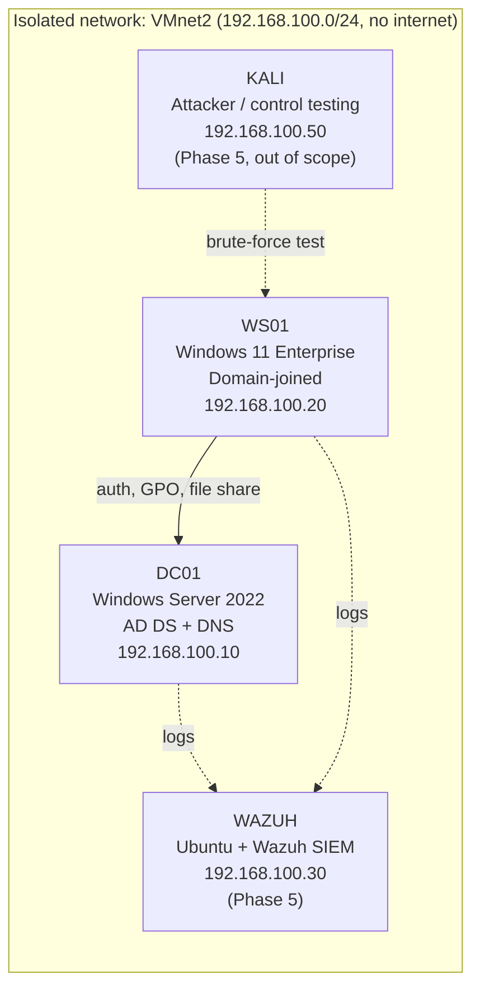

# NIST SP 800-171 Home Lab Assessment

I built a small Active Directory environment in VMware and assessed it against **NIST SP 800-171 Rev. 2**, the standard behind **CMMC Level 2**. The goal was to go beyond configuring controls: I tested each one, collected evidence, and tracked the gaps in a Plan of Action & Milestones (POA&M).

> **Note:** This is an isolated home lab. "Restricted-Data" is a fictional label standing in for Controlled Unclassified Information (CUI). All data, users, and systems are simulated. No employer systems or data are included.

---

## Lab Environment

| Component | Details |
|---|---|
| Hypervisor | VMware Workstation Pro, host-only network, static IPs, no DHCP |
| Domain | `bradley.lab` |
| Directory structure | OUs: Admins, Lab Users, Workstations, Restricted-Workstations, Groups |
| Accounts | Standard users, a negative-test user, and a separate admin account |
| Restricted data | `\\DC01\Restricted-Data`, limited to the `Restricted-Data-Users` group |

---

## Assessment Scope & Results

Four control families (51 requirements): **Access Control (3.1)**, **Audit & Accountability (3.3)**, **Identification & Authentication (3.5)**, **Media Protection (3.8)**.

| Status | Count |
|---|---|
| ✅ Met | 14 |
| 🟡 Partially Met | 2 |
| ❌ Not Met | 1 |
| ➖ N/A | 5 |
| ⏳ Not yet assessed | 29 |

*(Updated as phases are completed. Full detail in `NIST-800-171-Gap-Assessment.xlsx`.)*

---

## Controls Tested

| Control | Requirement | How it was implemented | Test & evidence |
|---|---|---|---|
| **3.1.1 / 3.1.2** | Limit access to authorized users and permitted functions | Group-based NTFS + share permissions on `Restricted-Data` | Authorized user opened share ✅ · unauthorized user denied ❌ → [allowed](evidence/3.1.1-jsmith-access-allowed.png), [denied](evidence/3.1.1-adoe-access-denied.png) |
| **3.1.5** | Least privilege | Removed `Domain Users` from folder ACL; granted only the restricted group | [NTFS permissions](evidence/3.1.5-ntfs-permissions.png) |
| **3.1.6** | Separate admin accounts | Daily account vs. dedicated admin account | Directory structure |
| **3.1.8** | Limit unsuccessful logon attempts | Lockout after 5 attempts / 15 min (Default Domain Policy) | Account locked after 5 bad passwords → [lockout](evidence/3.1.8-account-lockout.png) |
| **3.1.9** | Security notice | "AUTHORIZED USE ONLY" banner via GPO | [banner](evidence/3.1.9-logon-banner.png) |
| **3.1.10** | Session lock | 15-minute inactivity limit via GPO | GPO setting, [gpresult](evidence/gpo-applied-gpresult.png) |
| **3.3.1 / 3.3.2** | Audit logs traceable to users | Advanced audit: logon, credential validation, account management | Event 4740 names the locked-out user → [event](evidence/3.3.1-event-4740-lockout.png) |
| **3.3.7** | Time synchronization | Fixed time zone and clock drift; domain time hierarchy | See *Key Finding* below |
| **3.5.7 / 3.5.8 / 3.5.10** | Password complexity, history, no reversible encryption | Min 12 chars, complexity on, 24 remembered | Weak password rejected → [policy](evidence/3.5.7-password-policy.png) |

---

## Key Finding: Time Synchronization (3.3.7)

After promoting the domain controller, its clock was **three hours off**, and the workstation later drifted the same way. That looks minor, but:
- **Kerberos authentication fails** when clocks differ by more than 5 minutes.
- **Audit log timestamps become unreliable**, which undermines any investigation.

**Fix:** corrected the time zone, reset the clock, enabled host time sync, and configured the workstation to sync from the domain hierarchy (`w32tm /config /syncfromflags:domhier`).

---

## Open POA&M Items

| ID | Control | Gap | Risk | Planned fix |
|---|---|---|---|---|
| POAM-01 | 3.5.3 | No multifactor authentication | High | Pilot MFA on the admin account, then all users |
| POAM-02 | 3.1.7 | Privileged function use not audited | Moderate | Enable sensitive privilege use + process creation auditing |
| POAM-03 | 3.3.1 | Logs stored locally only | Moderate | Deploy Wazuh SIEM; define 90-day retention *(Phase 5)* |

---

## Project Phases

- [x] **Phase 1:** Domain controller (`bradley.lab`), isolated network, static IPs
- [x] **Phase 2:** OUs, role-based groups, separate admin account
- [x] **Phase 3:** Domain-joined workstation; access control test (allow/deny)
- [x] **Phase 4:** Group Policy hardening (lockout, banner, session lock, audit logging); tested
- [ ] **Phase 5:** Wazuh SIEM + Sysmon; brute-force from Kali and detect it
- [ ] **Phase 6:** Vulnerability scanning (before/after), network segmentation, MFA

---

## Repository Contents

| File | Description |
|---|---|
| `NIST-800-171-Gap-Assessment.xlsx` | Control-by-control assessment, POA&M, and summary |
| `docs/Lab-Notes-bradley-lab.pdf` | Build log, issues found and fixed, controls demonstrated |
| `evidence/` | Screenshots supporting each tested control |

---

## What I Learned

- **Configuring a control and proving it are different things.** Testing the lockout and the deny case is what turned settings into evidence.
- **Details matter.** A wrong clock or a leftover `Domain Users` permission can quietly break a control.
- **Group Policy scope matters.** Computers had to be moved out of the default container into an OU before workstation GPOs could apply.
- **UAC enforces least privilege even for admins.** Elevation was still required to view computer policy results.

## References

- [NIST SP 800-171 Rev. 2](https://csrc.nist.gov/pubs/sp/800/171/r2/upd1/final)
- NIST SP 800-171A (assessment procedures)
